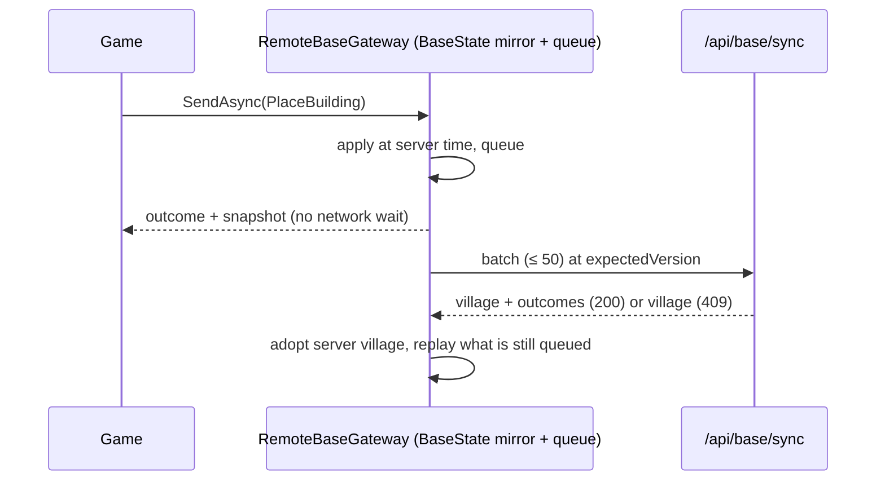

# 0006 — Client Sync: An Optimistic Mirror, a Command Queue, and a Server That Deals the Raids

- **Date:** 2026-10-13
- **Status:** Accepted

## Context

The server holds the village (ADR 0005). The game reads the village twice a second and before every tap, and a tap has to answer at once. A phone also loses its connection on trains, in basements and in the Marchlands. The rules are deterministic and shared (ADR 0002), so the device can run exactly what the server runs.

## Decision

`RemoteBaseGateway` replaces `LocalBaseGateway` behind the unchanged `IBaseGateway` port.

- **Reads:** come from a `BaseState` mirror. The village clock is the device clock plus the skew to the server time sent in every answer.
- **Commands:** apply to the mirror at once and wait in a queue. A background exchange sends up to 50 at the version the mirror is built on. Every answer replaces the mirror with the server's village, then replays the commands that are still queued. A 409 applied nothing, so the batch goes again on top of the newer village. A command that the server turns down is dropped; the server's village has already corrected the mirror.
- **BeginNight goes through the server:** the raid's budget depends on the server's clock and state, so the queue is flushed first and the plan is the one the server dealt. Without a connection, the Lamps don't light, and the game says why. ResolveNight is queued like any other command: the server replays the same Night from the same inputs.
- **Development commands** (finish now, raise Tension, record a Night) are refused on the device, just as the server refuses them.
- **Offline:** the last server village and the queue sit in a cache file (`village-cache.json`), so a restart without a connection resumes play. On a first launch without a connection, the player gets a local village. When the server answers, a guest account is created and the queue replays onto its fresh village.
- **Identity:** a guest token in PlayerPrefs. A 401 drops the token, so the next exchange starts a new guest. Real accounts come later.
- **Retries:** after a failure the client waits 2, 5, 15, then 30 s. With nothing queued, it pulls the village every 30 s, which is well inside the server's 240 requests per minute.

## Consequences

### Positive

- Taps feel local, and the server still has the final say on every amount.
- The game plays offline except for starting a Night, and nothing queued is lost on a restart.
- It needs no new server endpoints. The wire format was checked both ways against the live server (`WireFormatProbe`).

### Negative

- A command's effect can shift slightly when the server applies it a little later (for example, Timber collected a second later). The player sees the mirror snap to the server's village.
- Taps made on a first launch with no connection replay onto a server village created later, at the server's time.
- A guest token lives on one device. Reinstalling the app loses the village until accounts exist.
