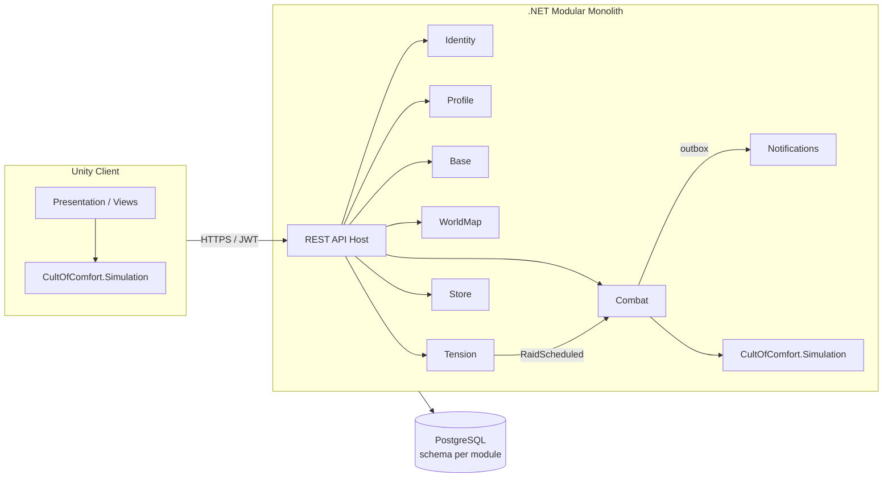
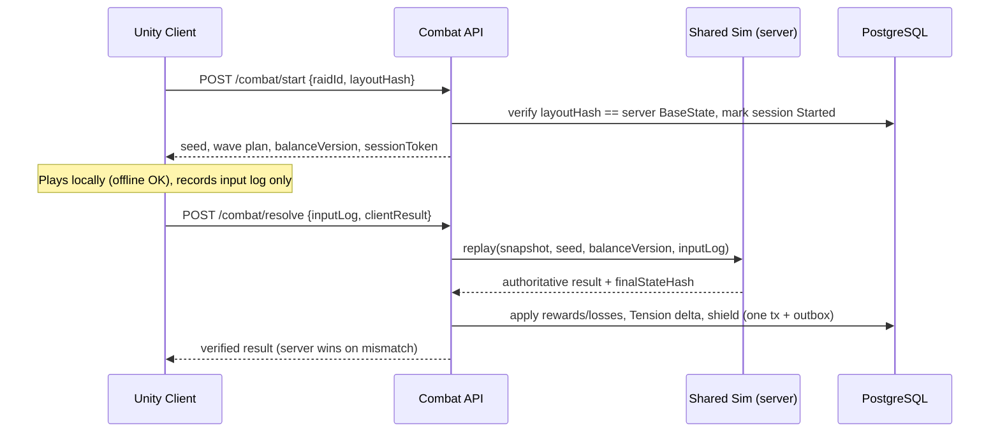

# Technical Architecture Blueprint (Unity ↔ .NET)

## System Overview



## Backend Modules

Modular monolith, one PostgreSQL database, **one schema per module**. Each module is hexagonal (Domain / Application / Infrastructure; ports in Application). Modules communicate via in-process integration events + transactional outbox — never by reading each other's tables. See [ADR 0001](../adrs/0001-modular-monolith-backend.md).

| Module | Owns | Persistence |
|---|---|---|
| Identity | Accounts, device auth, JWT | Relational |
| Profile | Player profile, entitlements, cosmetics | Relational |
| Base | BaseState aggregate, economy, queues, research | Aggregate row + `jsonb` buildings, `xmin` concurrency |
| WorldMap | Shards, nodes, influence, missionaries | Relational (`node_influence` indexed by node & player) |
| Tension | Tension state, Authority logic | Relational, `predicted_crossing_at` indexed |
| Combat | RaidEvents, sessions, verification | Relational + input log `jsonb` |
| Store | Receipt validation (Apple/Google), Silver Pennies | Relational, append-only ledger |
| Notifications | Push delivery | Outbox table |

**Shared library:** `CultOfComfort.Simulation` (netstandard2.1, zero dependencies) — balance formulas, wave generator, combat sim. Referenced by both Unity and server. See [ADR 0002](../adrs/0002-deterministic-shared-simulation.md).

## Data Models

### PlayerProfile

```json
{
  "playerId": "8f1c2e4a-...",
  "displayName": "Brother Kevin",
  "shardId": "eu-01",
  "hearthLevel": 3,
  "era": "Mud",
  "balanceVersion": "2026.10.1",
  "wallet": { "silverPennies": 120 },
  "entitlements": {
    "buildQueues": 2,
    "offlineAccrualHours": 12,
    "ownedCosmetics": ["outfit.linen_standcollar", "hearth.whitewashed"]
  },
  "equipped": { "cultistOutfit": "outfit.linen_standcollar", "hearthSkin": null },
  "shield": { "untilUtc": "2026-10-09T22:00:00Z", "reason": "PostRaid" },
  "version": 42
}
```

### BaseState

Server-computed snapshot; resource amounts are valid at `asOfUtc` (see [ADR 0003](../adrs/0003-lazy-evaluated-economy.md)).

```json
{
  "playerId": "8f1c2e4a-...",
  "stateVersion": 1187,
  "serverTimeUtc": "2026-10-09T14:03:11Z",
  "layoutHash": "sha256:9a1f...",
  "resources": {
    "timber":   { "amount": 1840, "cap": 6000, "ratePerHour": 600, "asOfUtc": "2026-10-09T14:03:11Z" },
    "scrap":    { "amount": 212,  "cap": 6000, "ratePerHour": 40,  "asOfUtc": "2026-10-09T14:03:11Z" },
    "peat":     { "amount": 530,  "cap": 6000, "ratePerHour": 35,  "asOfUtc": "2026-10-09T14:03:11Z" },
    "devotion": { "amount": 96,   "cap": 6000, "ratePerHour": 22,  "asOfUtc": "2026-10-09T14:03:11Z" }
  },
  "comfort": { "score": 145, "squalor": 30 },
  "cultists": { "total": 12, "idle": 2, "demoralizedUntilUtc": null },
  "grid": { "width": 24, "height": 24 },
  "buildings": [
    { "id": "b_01", "type": "core.hearth", "level": 3, "x": 12, "y": 12, "state": "Active" },
    { "id": "b_17", "type": "tower.slurry_chute", "level": 2, "x": 10, "y": 6, "rot": 90, "state": "Active" },
    { "id": "b_03", "type": "econ.midden_sorter", "level": 3, "x": 4, "y": 12, "state": "Upgrading",
      "workers": 2, "job": { "targetLevel": 4, "endsAtUtc": "2026-10-09T15:10:00Z" } }
  ],
  "research": {
    "active": { "id": "res.plumbing_probably", "endsAtUtc": "2026-10-10T02:00:00Z" },
    "completed": ["res.leverage"]
  },
  "missionaries": [
    { "id": "m_1", "state": "Preaching", "nodeId": "n_8812", "endsAtUtc": "2026-10-09T18:00:00Z" }
  ],
  "activeRaidId": "r_5531"
}
```

### WorldNode (client projection — full influence list stays server-side)

```json
{
  "nodeId": "n_8812",
  "shardId": "eu-01",
  "hex": { "q": 14, "r": -3 },
  "type": "Village",
  "name": "Lower Wetbottom",
  "authority": { "id": "auth_44", "kind": "Bishop", "name": "Bishop Odo the Damp", "level": 3 },
  "receptivity": 0.65,
  "squalor": 80,
  "suspicion": 0.10,
  "yield": { "resources": { "timber": 120, "peat": 40 }, "per": "hour", "atFullInfluence": true },
  "influence": {
    "capacity": 100,
    "patron": { "playerId": "c33a...", "displayName": "Sister Wendy", "value": 44.1 },
    "top": [ { "playerId": "c33a...", "value": 44.1 }, { "playerId": "8f1c...", "value": 17.2 } ],
    "mine": 17.2
  },
  "version": 551
}
```

### RaidEvent (returned by `/api/combat/start`)

```json
{
  "raidId": "r_5531",
  "authorityId": "auth_44",
  "tier": "Standard",
  "seed": 3141592653,
  "balanceVersion": "2026.10.1",
  "layoutHash": "sha256:9a1f...",
  "waves": 4,
  "warningEndsAtUtc": "2026-10-09T22:00:00Z",
  "sessionToken": "eyJ...HMAC-signed(raidId, seed, layoutHash, exp)"
}
```

## API Endpoints

| Method | Endpoint | Purpose |
|---|---|---|
| POST | `/api/auth/device`, `/api/auth/refresh` | Device-bound login, JWT |
| GET | `/api/profile` | Profile + entitlements |
| GET | `/api/config/balance?v=` | Versioned balance tables (CDN-cached) |
| GET | `/api/base` | Full BaseState evaluated at server time |
| POST | `/api/base/sync` | **Command batch**, not state upload: `[{seq, idempotencyKey, type: "Upgrade", buildingId}, …]` + `expectedStateVersion`. Returns per-command accept/reject, new `stateVersion`, deltas. `409` on version conflict → client re-pulls |
| POST | `/api/research/start` | Start research |
| GET | `/api/world/nodes?q=&r=&radius=` | Nodes in viewport |
| GET | `/api/world/nodes/{id}` | Node detail |
| POST | `/api/missionaries` | Dispatch `{nodeId, durationHours}` |
| POST | `/api/missionaries/{id}/recall` | Early recall (partial influence) |
| GET | `/api/tension` | Tension per Authority + `predictedCrossingAt` (shown in UI as "rumours") |
| POST | `/api/tension/{authorityId}/tithe` | Pay tithe |
| GET | `/api/raids/active` | Current scheduled raid + roster preview |
| POST | `/api/combat/start` | Lock layout, consume single-use token, return RaidEvent |
| POST | `/api/combat/resolve` | Submit `{raidId, sessionToken, inputLog[], clientResult{stars, hearthHp, finalStateHash}}` |
| GET | `/api/combat/{raidId}/report` | Server-verified result + replay data |
| POST | `/api/store/verify` | Store receipt validation → entitlements / Silver Pennies |

## Combat Flow



## Anti-Cheat (strongest → weakest)

1. **Server-authoritative economy** — client sends *intents*, never amounts. Production = `amount + rate × (serverNow − asOf)`, capped. Device clock manipulation does nothing.
2. **Deterministic replay verification** — Night sim is a pure function `f(layoutSnapshot, seed, balanceVersion, inputLog) → result`. Input log is tiny (3–5 interventions as `{tick, action, target}`), replay costs ms of CPU. Server result is authoritative; client result only for UX and mismatch flagging.
3. **Determinism discipline** (mandatory for #2):
   - Fixed-point math (Q16.16 / Q32.32 struct) — no `float` in the sim.
   - Fixed 20Hz tick; seeded PRNG (PCG / xorshift) owned by the sim.
   - Grid pathfinding with stable tie-breaking; no `Dictionary` iteration-order dependence.
   - Unity physics, `Time.deltaTime`, coroutines are **view-only** — Unity renders and interpolates sim state.
   - CI test: same seed + input log on server vs. Unity IL2CPP build → identical `finalStateHash`.
4. **Snapshot lock** — `/combat/start` freezes `layoutHash`; base edits rejected until resolve.
5. **Single-use signed session** — HMAC token binds `raidId + seed + layoutHash + expiry`. Start-then-abandon auto-resolves with empty input log (no seed re-rolling).
6. **Plausibility checks** — intervention cooldowns/costs respected, tick count matches sim length, resolve before `deadline + grace` (2h grace covers offline play).
7. **Anomaly flagging** — mismatch rate per account, 3★ rate vs. power ratio, shadow re-sim on a sample.
8. **Optimistic concurrency** — Postgres `xmin` as EF Core concurrency token on BaseState + idempotency keys on commands. Prevents double-spend via retries / parallel devices.

**Proportionality:** pure PvE with no player-vs-player damage — a cheater only inflates their own progress and influence share. Deterministic replay + server economy is sufficient; kernel-level anti-cheat would be overkill.
