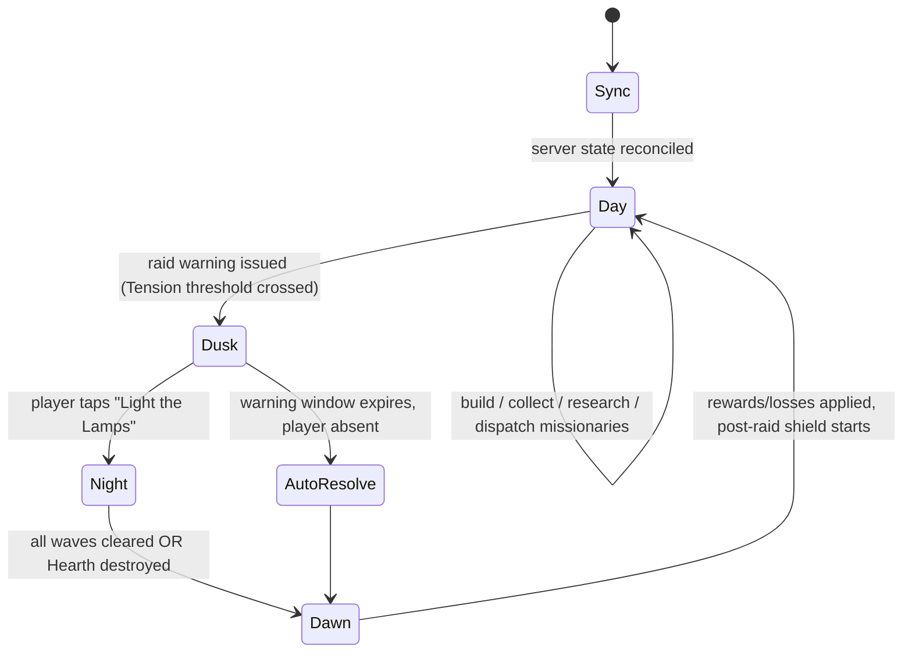

# 01 — Core Gameplay Loop & State Machine

## Macro Loop

**Design rule:** Night is not on a real-time clock. Nights are *caused* by Tension (see [04](04-world-map-and-tension.md)) and the player gets a warning window to play them. Respects mobile session patterns and makes cause → effect legible.

## Day Phase — Economy & Base Building

| Action | Input | Server effect | Session cadence |
|---|---|---|---|
| Collect | Tap producer / "Collect all" | Lazy-evaluated resources move into storage (capped) | Every login |
| Build / Upgrade | Place on grid, confirm | Deduct cost, start timer in a build queue | 1–3 per session |
| Assign Cultists | Drag cultist onto building | Changes production rate (diminishing returns per slot) | Occasional |
| Research | Pick tech-tree node | Deduct cost, start research timer (1 slot) | 1 per session |
| Layout Defense | Move towers/walls | Changes `layoutHash`; locked during Dusk/Night | Pre-raid |
| Dispatch Missionary | Choose node, duration, provisions | Travel → preach → influence gain | 1–4 per day |
| Pay Tithe | Spend resources toward an Authority | Reduces Tension (major sink) | Reactive |
| Manage Heat | Toggle heated buildings | Trade Peat upkeep vs. Comfort | Rare |

## Dusk — Preparation (warning window, default 8h)

- Push notification, e.g. *"Lord Wulfric's men have been seen sharpening things. Expect company."*
- Player sees enemy roster preview (unit types, wave count), not exact paths.
- Player may rearrange layout, repair, pre-load Night consumables (Peat for steam towers, cistern water).
- Starting the Night calls `/api/combat/start`: layout snapshot is locked and the single-use session token is consumed.

## Night Phase — Tower Defense (target 3–5 min)

| Element | Spec |
|---|---|
| Structure | 3–5 waves, ~60s each, 10s gaps |
| Primary objective | Protect **the Hearth** (central hub, has HP) |
| Secondary objective | **Morale** — Bishop units attack it by "preaching" at Devotion buildings |
| Passive layer | Towers auto-fire |
| Active layer | **Interventions**: 3–5 manual actions per Night with cooldowns and Peat/Scrap costs (open sluice gate, ring alarm bell to speed cultists, drop emergency barricade, relight tower) |
| Build lock | No new towers; only pre-stocked emergency barricades |
| Cultists | Auto-repair crews; ringing the bell speeds them up at a Morale cost |

### The Prophet on the battlefield (prototype, balance 2026.10.2)

The time traveller is the player's hero unit. Tap the ground to walk him; he swings a 2024 umbrella at anything in reach.

- **Blocking.** Enemies that come within reach of him stop on the road and fight him instead of marching: Levies at 0.75 tiles, men-at-arms at 1 tile. He holds at most **3** at once; the rest walk past. Holding them still inside tower range is the point, and it costs him health.
- **Zealots** (from wave 2): light and quick, and they throw hymnals at him from **2.5 tiles**. They punish a Prophet parked next to the road.
- **Health 120.** He regains 1 HP every 0.5 s once he hasn't been hit for 3 s. At 0 he **swoons** for 10 s: no walking, umbrella or skills, and enemies ignore him. He gets up at half health and is left alone for 2 s. Move orders given while he's down are carried out when he gets up.
- **Skills:** Phantom Voice (nearby enemies walk backwards, 15 s cooldown) and **Hot Stone Therapy**: tap the skill, then a tile within 4 tiles of him. It deals 45 damage in a 1.2-tile radius and muddies whoever survives, setting up Flinger crits (20 s cooldown).
- **The decision each Night:** where to stand, when to retreat before he swoons, and whether to spend stones on a clump at the front or save them for the men-at-arms.

## Win/Loss — Single Night

| Outcome | Condition | Result |
|---|---|---|
| **Win 3★** | All waves cleared, Hearth ≥ 80% HP, Morale ≥ 50% | Tension −40, full salvage loot (Scrap), Devotion bonus |
| **Win 2★** | All waves cleared, Hearth ≥ 40% | Tension −40, 60% loot |
| **Win 1★** | All waves cleared, Hearth > 0 | Tension −35, 30% loot |
| **Loss** | Hearth HP = 0 **OR** Morale = 0 (cultists flee to the woods) | Lose 15% of *unprotected* stored resources (Vault protects a %), Tension −60 ("they've made their point"), damaged buildings become *Soggy* (inactive until cheaply repaired) |
| **Auto-resolve** | Player absent at deadline | Server runs the same sim with zero interventions; reward capped at 2★ |

## Ethics Guardrails

- No permanent building destruction.
- Cultists never die — they become "Demoralized" for 2h.
- 12h shield after every raid; maximum 2 raids per 24h.
- New-player shield until Hearth level 2.
