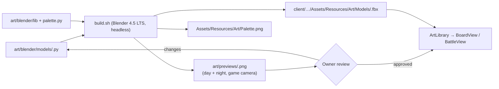

# Art Direction & Asset Pipeline — Design

- **Date:** 2026-10-10
- **Status:** Approved in brainstorming, pending spec review
- **Scope:** Everything visible in the game: 3D models, effects, HUD art, fonts, lighting

## Intent

Replace the placeholder primitives with a real, coherent look **designed together with the owner and produced by Claude**, not bought. Quality bar: roughly Kingshot: polished and instantly readable on a phone.

**Done when:** one **Night** and one **Day** screenshot taken on the Pixel show the new models and buildings, and the owner would put them on a store page.

## Decisions

| Topic | Decision | Notes |
|---|---|---|
| Palette | **Muddy Satire**: earthy, desaturated 10th-century browns; 2024 junk always in loud neon | The anachronism is the visual joke |
| Proportions | **Chunky chibi** (head ≈ ½ of height); **the Prophet is a head taller** than locals | "He's from 2024 and ate vegetables" |
| Protagonist | **Male**, the tired time traveller as sketched | Docs and code already say "he" |
| Setting | **The Marchlands**: a fictional muddy borderland | Roman bath ruin core + Slavic log banya bolted on + Saxon thatch + blue tarp |
| Lighting | **Golden Mud**: low warm sun, long cool shadows by day; teal moonlight against orange fire by night; thin moonlit rim on units | Keeps mud alive and Nights readable |
| HUD | **Manuscript + Junk**: the world speaks in illuminated manuscript; the Prophet's interventions are sticky notes, tape, hazard stripes and marker scribbles on top | Two voices: the Dark Ages and the man from 2024 |
| Production | **Blender Python scripts** in the repo, run headless; characters animated **in code** from rigid named parts | Skeletal animation can be added later if ever needed |

## Style guide

### Palette (single shared texture; every model samples these swatches)

| Group | Swatches |
|---|---|
| Ground & nature | Grass `#6f7a49`, Grass alt `#687244`, Road mud `#8a6a47`, Wet mud `#4e3520`, Water `#5b7f86`, Foliage `#6f8a3a`, Pine `#4c5b33` |
| Building materials | Roman marble `#d7cfbf`, Worn stone `#b8b0a2`, Fieldstone `#7f7b73`, Fresh log `#9b7a52`, Old wood `#6d4c2f`, Tarred wood `#4a321e`, Thatch `#a08450`, Daub `#bfa98a` |
| People | Prophet skin `#e7b590`, Local skin `#d9a37f`, Linen `#ece6d6`, Levy wool `#9c8460`, Mail `#8e9399`, Zealot red `#a8432c`, Wulfric's red `#8a2f24`, Gold trim `#d9b45a` |
| 2024 junk | Cone orange `#ff5a00`, Tarp blue `#1f6dff`, Hi-vis yellow `#e8ff3a`, Flip-flop pink `#ff4fa3`, Umbrella black `#2b2b2e` |
| Emissive | Fire `#ffb04d`, Ember / hot stone `#ff7a1f`, Window `#ffcf80`, Moon rim `#9fe3ea` |

### Shape rules

1. **Medieval things are wonky, 2024 things are perfect.** Logs, walls and roofs lean 2–4° with uneven edges; cone, tarp and umbrella are crisp geometry.
2. **Chunky, small bevels.** Clothes, buildings and props are flat-shaded facets; **skin (heads, hands) is smooth-shaded** so people read as friendly humans, not carvings. No detail smaller than ~1/10 of a tile.
3. **Silhouette first.** Levy = hood + pitchfork; Man-at-arms = pointed nasal helmet + kite shield; Zealot = tonsure + book; Prophet = tallest + umbrella.
4. **Scale:** 1 tile = 1 m. Locals ≈ 0.8 m, Prophet ≈ 1.0 m, towers 1.5–2 m, Hearth L1 ≈ 2 tiles wide.
5. **Friendly, human faces** (owner review of the first Prophet: faceted heads and rectangle features read as scary): round smooth head, rounded eyes with a small highlight, eyebrows that carry the expression, ears, a small round nose, a short soft mouth. Deadpan humour comes from brows and posture, never from creepy features.
6. **Teams:** Wulfric's side carries red & gold; the cult wears linen and junk-neon.

### Budgets

- ≤ 2,200 triangles per character (raised from 1,500 after the Prophet review: smooth friendly faces cost ~2k; 30 units on screen ≈ 60k triangles, trivial for the target phones), ≤ 3,000 per building, ≤ 300 per prop/effect.
- One opaque material (palette texture) plus one emissive variant; GPU instancing on.
- Performance on the Pixel 10 development build: steady 60 fps in Dusk, ≥ 50 fps during a busy Night.

## Pipeline



```
art/
  blender/
    lib/            palette, shape helpers (bevelled box, low-poly cone, log, stake, …), export, preview render
    palette.py      the swatches above — single source of truth
    models/         one script per asset
  previews/         review renders (committed)
  build.sh          build all, or one asset by name
client/CultOfComfort.Unity/Assets/Resources/Art/
  Models/           exported .fbx (generated, committed)
  Palette.png       generated palette texture
  Materials/        Palette (URP Lit) and PaletteEmissive
```

- **Blender** 4.5 LTS installed user-locally in `~/Applications` (no sudo), documented in the README like Unity.
- **Build checks** (fail the build): triangle budget exceeded; a face colour that is not a palette swatch; a character missing a required named part.
- **Characters** are a root with named child parts (`Body`, `Head`, `ArmL`, `ArmR`, plus props such as `Umbrella`, `Pitchfork`, `Shield`, `Hymnal`), pivoted so code can rotate them naturally (arms at the shoulder, body at the feet).
- **HUD art** is authored as SVG and rasterised to PNG for UI Toolkit (9-slice for stretchable panels). Fonts: **IM Fell English / IM Fell English SC** (manuscript) and **Permanent Marker** (the Prophet's scribbles), both OFL.

## Production order

Each step ends with day + night previews and the owner's approval before the next starts.

| Step | Content |
|---|---|
| 0 | Tooling: Blender install, palette texture, helpers, preview renderer, export, a test cube end to end |
| 1a | **The Prophet**: character template (parts, eyebags face, neon sandals, belt bag, sunglasses, umbrella) |
| 1b | **Hearth L1**: building template (Roman bath ruin, steaming pool, blue tarp) |
| 2 | Night set: Levy, Man-at-arms, Zealot; Sapling Flinger, Slurry Chute (wattle hopper + plank ramp); grass/road tiles, water edge, rocks, pines, spawn gate (Wulfric's banner), torches, traffic cone; effect meshes (mud glob/splat, flung rock, hot stones, steam, flood, hymnal, poof) |
| 3 | HUD kit: parchment 9-slice panel, sticky notes ×3, tape strips, hazard-tape meter, skill icons (sluice, tin can, hot stones, speed), resource icons, fonts; restyle `HudView` + `Hud.uss` |
| 4 | Day village: Hearth L2 (log banya bolted on, stone chimney, second tarp) and L3 (thatched upper floor, junk copper pipes, small water wheel); Woodcutter's Lean-to, Peat Cut, Cistern, Storage Hut, cultist hut |
| 5 | Unity lighting: Golden Mud day/night rigs (sun/moon, colour grading, bloom on emissives), shadows if ≥ 50 fps else blob shadows; final store-page screenshots from the Pixel |

Out of scope here: Hearth L4–10, Comfort-era buildings, the world map: they follow with building creation.

## Unity integration

- **`ArtLibrary`**: loads prefabs/models by name from `Resources/Art`; returns `null` when missing so callers fall back to the existing `Shapes` primitives. The game stays playable at every step.
- **`BoardView` / `BattleView`**: request models from `ArtLibrary` instead of `Shapes.Create`. Simulation and game rules are untouched.
- **`PartAnimator`**: code-driven animation on named parts, fed by state the views already have:

| State | Motion |
|---|---|
| Idle | Breathing on `Body`, occasional `Head` turn |
| Walk | Body bob, arm swing, lean into the direction |
| Attack | Prophet umbrella swing · Levy pitchfork jab · Man-at-arms shield bash · Zealot throw |
| Hit | Quick squash + white flash |
| Swoon | Tip backwards at the feet pivot, small bounce, lie flat |
| Revive | Pop up, brush-off shake |

## Verification

- **Owner review** of every asset's day/night preview before it is wired in.
- **Automated:** all 56 simulation tests and the determinism probe stay green (art must not change the hash); existing Unity EditMode/PlayMode tests stay green; a new EditMode test asserts every `ArtLibrary` entry loads and has its required named parts.
- **Build-time checks** in `build.sh` (triangle budget, palette-only colours, required parts).
- **On device:** Pixel screenshot and frame rate (development build) after each step.
- **Commits:** scripts, previews and exported models are committed and pushed as **adziusmaster** (`adzius.lech@gmail.com`), never with a Co-Authored-By trailer.
